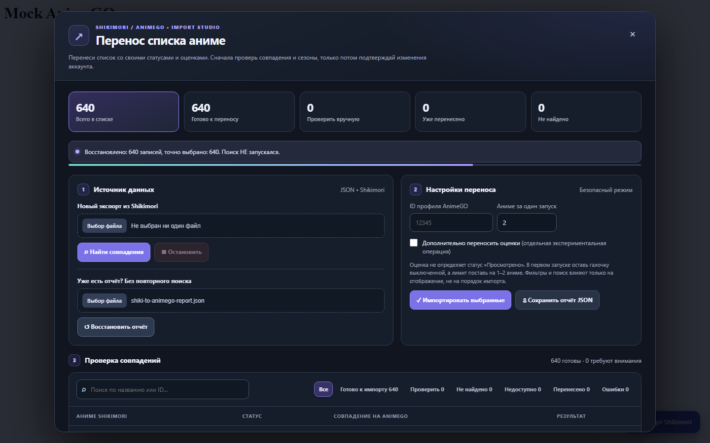
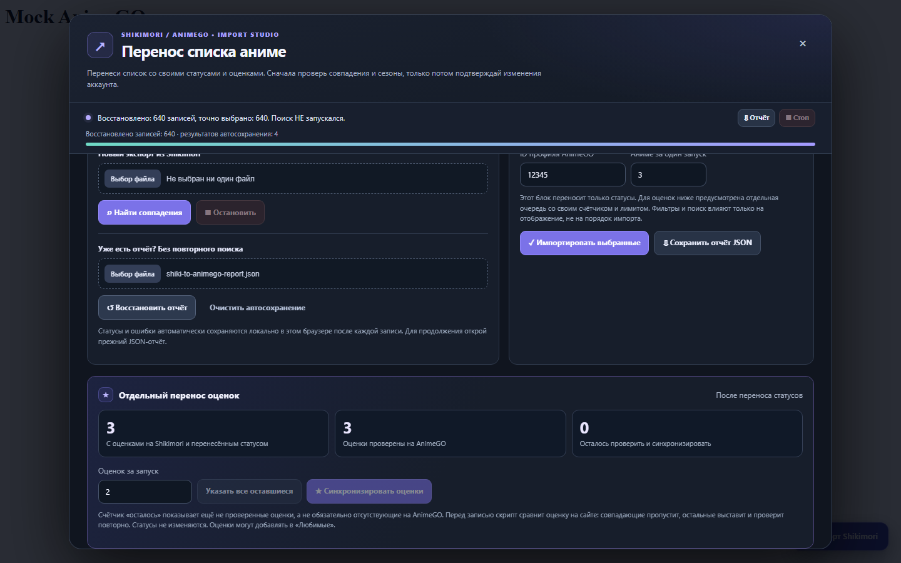

# Shikimori → AnimeGO Importer

**[Русский](#русский) · [English](#english)**

[](LICENSE)
[](https://github.com/SvisBee/shikimori-to-animego/releases/latest)

## Русский

Бесплатный неофициальный **Tampermonkey userscript** для переноса списка аниме из Shikimori на **[anime-go.org](https://anime-go.org/)**. Это *не* `animego.me`: сайты разные, скрипт поддерживает только `anime-go.org`.

**[Установить последнюю стабильную версию](https://github.com/SvisBee/shikimori-to-animego/releases/latest)** · [Сообщить об ошибке](https://github.com/SvisBee/shikimori-to-animego/issues)

### Возможности

- Импорт JSON-экспорта Shikimori, поиск названий и **предпросмотр без записи**; автоматический выбор только при уникальном точном совпадении
- Раздельные статусы: **Смотрю, Просмотрено, Отложено, Брошено, Запланировано**
- **Отдельный перенос оценок**: счётчики «можно проверить / проверено / осталось», собственный лимит, кнопка «Указать все оставшиеся»
- Проверка текущего статуса и оценки до записи, проверка результата после неё; уже совпадающие оценки не отправляются повторно
- Локальное автосохранение после каждого обработанного тайтла, восстановление результатов из JSON-отчёта
- Закреплённый прогресс, ошибки на виду, подтверждение внутри окна, поиск и фильтры, мобильная версия

### Установка и использование

1. Установи [Tampermonkey](https://www.tampermonkey.net/) в Edge, Chrome или другом совместимом браузере и разреши запуск пользовательских скриптов.
2. Открой [страницу последнего стабильного выпуска](https://github.com/SvisBee/shikimori-to-animego/releases/latest), выбери прикреплённый **`shikimori-to-animego.user.js`** и установи его в Tampermonkey. Другие файлы скачивать не требуется.
3. Войди в аккаунт на **[anime-go.org](https://anime-go.org/)**, открой **свой профиль**, обнови страницу и нажми плавающую кнопку **«Импорт Shikimori»**.
4. Загрузи **JSON-экспорт Shikimori**. Скрипт найдёт совпадения. Проверяй сезоны, фильмы, OVA и спецвыпуски перед подтверждением.
5. Сначала перенеси **1–2 статуса** и проверь их в профиле. Если всё верно, увеличивай лимит. В случае ошибки импорт остановится.
6. После переноса статусов перейди к **«Отдельный перенос оценок»**. Сначала проверь **1–2 оценки**, затем нажми **«Указать все оставшиеся»**, чтобы автоматически заполнить количество.
7. **Сохрани итоговый JSON-отчёт**. После обновления страницы загрузи предыдущий отчёт через «Восстановить отчёт»; локальные checkpoint дополнят его уже обработанными результатами.

**Важно:** фильтры меняют только видимые строки, **не** очередь импорта. Не закрывай вкладку во время записи и не удаляй исходный экспорт Shikimori.

### Ограничения

- Нельзя переносить **«Пересматриваю»**, прогресс отдельных серий, даты, комментарии и пользовательские заметки.
- Некоторые тайтлы отсутствуют на AnimeGO, а у некоторых онгоингов пока нет нужного статуса. Не подменяй их другими сезонами.
- Оценивание на AnimeGO может добавить тайтл в **«Любимые»**. Оценка не означает «Просмотрено».
- Используются **неофициальные внутренние эндпоинты** AnimeGO; сайт может их изменить. Всегда сохраняй резервные копии и проверяй небольшой тестовый перенос.
- Счётчик «Осталось проверить» означает ещё **не проверенные**, а не обязательно отсутствующие оценки.

### Скриншоты





[Подтверждение переноса](docs/screenshots/confirmation.png) · [Мобильная версия](docs/screenshots/mobile.png)

*Все публичные скриншоты используют синтетические данные.*

### Конфиденциальность и безопасность

Полный экспорт обрабатывается локально в браузере и не загружается на сервер разработчика. Для поиска и изменения списка выполняются запросы к текущему сайту `anime-go.org`. Результаты, ID профиля и сообщения об ошибках хранятся в **localStorage на домене AnimeGO**, поэтому могут быть доступны скриптам самого сайта. Для приватных списков не используй общий компьютер; при необходимости очисти автосохранение через интерфейс.

**Не прикладывай к публичным GitHub issues** свои JSON-экспорты, отчёты, cookie, токены или другие личные данные. Репозиторий не связан с администрацией Shikimori или AnimeGO.

### Разработка

Для базовых тестов достаточно Node.js (без установки npm-зависимостей):

```bash
node --check shikimori-to-animego.user.js
node test.js
node test-report-compat.js
```

Дополнительные браузерные тесты: `node tests/ui-smoke.cjs`. Для них нужны `playwright-core` и Microsoft Edge; тестовые запросы к AnimeGO полностью подменяются и **не записывают реальные аккаунты**.

Читайте также [CONTRIBUTING.md](CONTRIBUTING.md) и [SECURITY.md](SECURITY.md). Лицензия [MIT](LICENSE).

---

## English

A free, unofficial **Tampermonkey userscript** to migrate your Shikimori anime list to **[anime-go.org](https://anime-go.org/)**. It does **not** support the unrelated `animego.me` website.

**[Install the latest stable release](https://github.com/SvisBee/shikimori-to-animego/releases/latest)** · [Report an issue](https://github.com/SvisBee/shikimori-to-animego/issues)

### Features

- Read Shikimori JSON exports, search titles and **preview without writing**. Only unique, exact title matches are automatically selected
- Independent status transfers: **Watching, Completed, On hold, Dropped, Planned**
- **Separate rating sync** with eligible/verified/remaining counters, a dedicated limit and an **All remaining** button
- Check current AnimeGO status and rating before writing, confirm both afterwards, and skip already-matching ratings
- Save local progress after every processed title and restore results from a previous JSON report
- Pinned progress and visible errors, in-app confirmation, filters/search and a responsive interface

### Install and use

1. Install [Tampermonkey](https://www.tampermonkey.net/) in a supported browser and allow userscripts.
2. Visit the [latest stable release](https://github.com/SvisBee/shikimori-to-animego/releases/latest), select the attached **`shikimori-to-animego.user.js`** and install it with Tampermonkey.
3. Sign in to **[anime-go.org](https://anime-go.org/)**, open **your own profile**, refresh and click **Import Shikimori**.
4. Import your **Shikimori JSON export** and review all title/season/OVA/movie matches before approving changes.
5. Test **1–2 status writes** first; verify them in your profile. Increase the batch limit only after confirming results.
6. Use **Separate rating sync** after statuses are done. Test **1–2 ratings**, then click **All remaining** to fill the batch count automatically.
7. **Download the JSON report**. To resume after a refresh, restore a previous report; local checkpoints will merge already processed results.

**Note:** filters only affect display, **not** the import queue. Keep your original export as a backup.

### Limitations

- **Rewatching**, episode progress, dates, notes and comments are not supported.
- Some titles are absent or have no applicable AnimeGO list status. Do not select a different season as a substitute.
- Ratings may affect **Favorites**; a rating does **not** mark a title Completed.
- AnimeGO endpoints are **unofficial and subject to change**. Start with a small trial and keep backups.
- **Remaining** means ratings not yet verified, not necessarily missing on AnimeGO.

### Screenshots


[Import confirmation](docs/screenshots/confirmation.png) · [Mobile layout](docs/screenshots/mobile.png)

*All public screenshots use synthetic data.*

### Privacy and development

The full export stays in the browser and is **not uploaded to a developer-operated server**. Requests go to the currently open AnimeGO site. Profile IDs and per-item results are stored in **localStorage on the AnimeGO domain**, accessible to that site's scripts. Avoid shared computers for private lists, and clear checkpoints when necessary.

**Never publish** personal exports, reports, session cookies, tokens or account information in public GitHub issues. This project is not affiliated with Shikimori or AnimeGO.

Basic tests require Node.js without npm dependencies:

```bash
node --check shikimori-to-animego.user.js
node test.js
node test-report-compat.js
```

Optional browser smoke test: `node tests/ui-smoke.cjs` (requires `playwright-core` and Microsoft Edge, with all AnimeGO network requests mocked).

See [CONTRIBUTING.md](CONTRIBUTING.md), [SECURITY.md](SECURITY.md). Licensed under [MIT](LICENSE).
