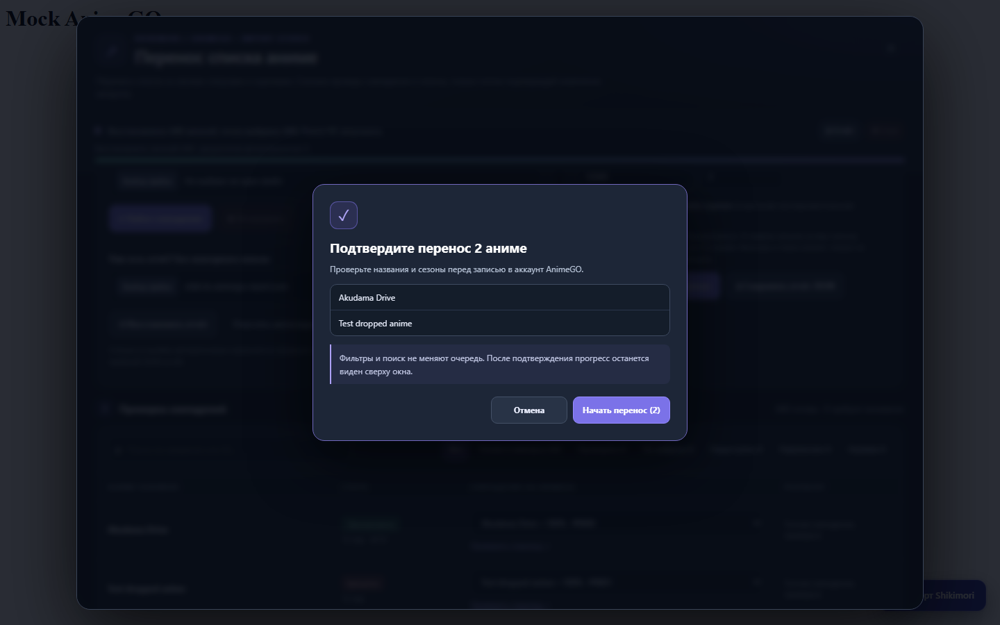
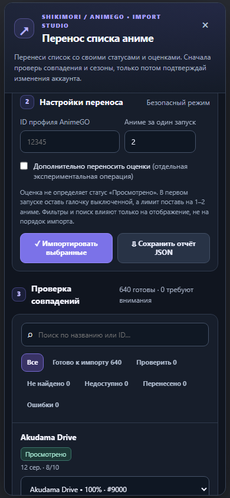

# Shikimori → AnimeGO Importer / Импортёр Shikimori → AnimeGO

**Русский** | [English](#english)

Неофициальный userscript для переноса списка аниме из Shikimori на **[anime-go.org](https://anime-go.org/)** (с дефисом). Сайт `animego.me` работает на другом движке и этой версией не поддерживается.

> **v0.7.0 Beta.** На настоящем аккаунте протестированы «Брошено» и «Просмотрено», включая сохранение двух разных тайтлов с оценками. **Новый интерфейс** протестирован отдельно в браузере на вымышленных данных; перед большим переносом проверьте небольшую партию на сайте. Сохраните исходный экспорт Shikimori и JSON-отчёт.

## Возможности
- **v0.7: отдельная синхронизация оценок.** После завершения переноса статусов восстанови JSON-отчёт. Скрипт покажет количество оценок Shikimori у уже перенесённых тайтлов, сколько проверено, сколько ещё осталось. Можно выбрать 1–2 оценки для теста или нажать **«Указать все оставшиеся»**.
- Проверяет реальный текущий статус и оценку на AnimeGO до записи. Если оценка уже совпадает, запрос `/rate` пропускается. После записи перепроверяются **и оценка, и статус**. Ошибки останавливают партию, результаты оценок тоже сохраняются в локальном checkpoint и в JSON-отчёте.

- **Встроенное подтверждение:** больше нет системного диалога Edge/Chrome, который скрывал импортёр. Названия выбранных аниме показываются внутри того же окна, затем сразу виден прогресс.
- Кнопки «Отмена» и Escape закрывают подтверждение без отправки запросов. Перед импортом отображается точное число записей и первые пять названий.

- **Прогресс всегда виден сверху окна:** текущий тайтл, обработано из партии, успешно, ошибки, остановка и сохранение отчёта. Причины остановки показываются рядом, без поиска нужной строки в таблице.
- **Автосохранение после каждой записи:** сохраняются только статусы, совпадения и сообщения об ошибках, не исходный экспорт. Восстанови старый JSON-отчёт в том же браузере и под тем же ID профиля, чтобы продолжить без повторного импорта уже обработанных тайтлов.
- Можно очистить локальное автосохранение кнопкой в интерфейсе; исходный JSON-отчёт при этом не изменяется.


- **Обновлённый интерфейс v0.6:** тёмная тема, сводные показатели, поиск и фильтры, таблица с подгрузкой по 50 строк, мобильные карточки, индикатор прогресса, доступные клавиатурные действия.
- Перед реальной записью показывается список тайтлов, которые будут изменены. **Фильтры и поиск влияют только на отображение**, а не на очередь импорта.

- Загрузка JSON-экспорта списка Shikimori и поиск тайтлов на AnimeGO.
- Предпросмотр без записи (**dry-run**) и ручная проверка совпадений, сезонов, OVA и фильмов.
- Восстановление результатов из `shiki-to-animego-report.json` без повторных сотен запросов.
- Раздельный перенос статусов **Смотрю, Просмотрено, Отложено, Брошено, Запланировано** через `/fav/set`.
- **Оценки теперь в отдельном блоке:** три счётчика, собственный лимит и кнопка «Указать все оставшиеся». Оценка может добавлять аниме в «Любимые», но не влияет на статус просмотра.
- Проверка состояния перед записью, подтверждение результата после записи, ограничение размера партии (по умолчанию 2), остановка и отчёт.
- Статус «Просмотрено» дополнительно сверяется в разделе твоего профиля.

**Пока не поддерживаются:** «Пересматриваю», количество просмотренных серий, даты, комментарии. Для некоторых текущих онгоингов AnimeGO ещё не предоставляет кнопку «Просмотрено»: скрипт пропускает их с сообщением об ошибке, не подменяя статус.

## Скриншоты интерфейса (тестовые данные)







*Скриншоты сделаны с подставными данными. Ни один реальный пользовательский экспорт не публикуется.*

## Установка

1. Установи [Tampermonkey](https://www.tampermonkey.net/) и разреши пользовательские скрипты в браузере.
2. Открой [shikimori-to-animego.user.js](./shikimori-to-animego.user.js) и установи версию **0.7.0**, заменив предыдущую.
3. Войди в аккаунт на [anime-go.org](https://anime-go.org/), открой **свой профиль** и обнови страницу.
4. Нажми «Импорт Shikimori». Скрипт возьмёт ID профиля из адреса, проверь, что указан именно твой.
5. Выбери JSON-экспорт Shikimori или загрузи уже сохранённый отчёт через «Восстановить результаты без поиска».
6. Проверь соответствие оригинальных названий и сезонов. Выставь лимит **1** и **не включай оценки** для первой проверки.
7. Нажми «Импортировать выбранные» и сравни результат со своим профилем. Только после успешного теста переходи к небольшим партиям.
8. **Для оценок:** ниже основных настроек найди блок «Отдельный перенос оценок». Убедись, что виден правильный счётчик; выбери **2** и нажми **«Синхронизировать оценки»**. Проверь результат в аккаунте.
9. Чтобы не вводить число вручную, нажми **«Указать все оставшиеся»**, затем повторно запусти синхронизацию. При ошибке импорт остановится, а после восстановления отчёта уже подтверждённые оценки будут пропущены.
10. Скачивай новый отчёт после каждой партии и сохраняй исходный экспорт.

**Осторожно:** `/fav/set` может переключать текущую отметку. Скрипт старается не затрагивать уже правильно отмеченные записи, но эти эндпоинты неофициальные и могут меняться. При непроверенном результате остановись и проверь профиль вручную.

## Технические детали

| Действие / Operation | Адрес / Endpoint |
|---|---|
| Поиск / Search | `GET /search?q=...` |
| Список статусов / List options | `GET /api/watchlist/{anime_id}` |
| Установить статус / Set status | `POST /fav/set` |
| Выставить оценку / Set rating | `POST /rate` |
| Проверить просмотренное / Verify completed | `GET /user/{profile_id}` |

## Проверка и разработка

Нужен Node.js, дополнительных npm-зависимостей нет:

```bash
node --check shikimori-to-animego.user.js
node test.js

# Optional browser UI smoke test (requires playwright-core and Edge)
node tests/ui-smoke.cjs
```

**Приватность:** локальный прогресс хранится в localStorage на домене anime-go.org и потенциально доступен самому сайту и его скриптам. Не запускайте импорт на чужих или общих компьютерах, если это нежелательно. Экспорт обрабатывается в браузере; скрипт обращается к текущему сайту AnimeGO, а не к серверу автора. Не прикрепляйте личные JSON-экспорты, cookie, токены и отчёты к публичным issues.

Лицензия MIT. [Сообщить об ошибке / Report an issue](https://github.com/SvisBee/shikimori-to-animego/issues).

---

## English

An unofficial userscript to migrate your Shikimori anime list to **[anime-go.org](https://anime-go.org/)** (with a hyphen). This is not compatible with the distinct `animego.me` website.

> **v0.7.0 Beta.** Both Dropped and Completed statuses have been successfully observed on a real account, including two correctly rated Completed titles. The **new interface** was separately tested in a mocked browser; verify a small live batch before bulk importing. Keep your Shikimori export and saved report.

### Features
- **v0.7: independent rating synchronization.** Restore your report after transferring statuses; the new panel counts eligible Shikimori scores, already confirmed ratings, and unverified ratings. Test 1–2 or use **All remaining** to populate the batch size automatically.
- Checks current AnimeGO status and rating before changing anything; matching scores skip `/rate`. Verifies **both rating and original list status** afterwards. Stops safely on a mismatch, and persists rating checkpoints in local storage and JSON reports.

- **In-app confirmation:** no more native Edge/Chrome confirmation dialog that obscures the importer. The selected titles appear inside the same interface and progress stays visible immediately after approval.
- Cancel and Escape dismiss the confirmation without sending write requests; the dialog shows the exact batch size and up to five titles.

- **Always-visible progress panel:** current title, batch progress, successful items/errors, Stop and Report actions, and an immediately visible failure reason.
- **Checkpoint after every processed item:** restore earlier results by loading the original JSON report in the same browser/profile. The complete export is never stored locally; only outcome metadata is saved.
- Checkpoint can be cleared from the interface without affecting the original JSON report.


- **Redesigned UI in v0.6:** dark theme, summary counters, filters/search, 50-row incremental rendering, responsive mobile cards, progress indicator, keyboard-friendly controls.
- The confirmation dialog shows the exact titles to be modified. **Search and filters affect display only**, not the import order.

- Read a Shikimori JSON export and search for corresponding AnimeGO titles.
- Dry-run with manual season/title review and strict punctuation-aware exact matching.
- Resume from an earlier `shiki-to-animego-report.json` without re-searching hundreds of titles.
- Transfer **Watching, Completed, On hold, Dropped and Planned** independently through `/fav/set`.
- Rating synchronization is a separate workflow with its own counters and automatic batch size. Ratings may affect Favorites but do not change watch status.
- Avoid toggling already-correct statuses, confirm writes, stop on critical errors, limit batch sizes (default 2), export detailed reports.
- Additionally verify Completed entries on the user's profile.

**Not currently supported:** Rewatching, episode progress, dates or comments. AnimeGO does not offer Completed for all ongoing titles, and the importer will not silently use another status.

### UI previews (synthetic data)

See the [desktop](docs/screenshots/desktop.png) and [mobile](docs/screenshots/mobile.png) screenshots above. Both use synthetic test records, not a real user's export.

### Installation and usage

1. Install [Tampermonkey](https://www.tampermonkey.net/) and enable userscripts in your browser.
2. Install [shikimori-to-animego.user.js](./shikimori-to-animego.user.js) **v0.7.0**.
3. Sign in to [anime-go.org](https://anime-go.org/), preferably open your own profile, and refresh.
4. Click **Import Shikimori**, check that the profile ID belongs to you.
5. Load a Shikimori JSON export or restore a previously saved report without searching.
6. Review all matches (including season/OVA/movie differences). Set the first test batch limit to **1** with ratings **off**.
7. Confirm the imported title in your AnimeGO profile. Increase batch size only after the initial live test succeeds.
8. **For ratings:** use the dedicated rating-sync section. Start with **2** ratings, confirm the result on your AnimeGO account, then choose **All remaining** to auto-fill the remaining number.
9. Rating results are checkpointed independently. Restore your previous report to resume without repeating already verified scores.
10. Save a JSON report after every major batch; keep the Shikimori export.

These are **unofficial site endpoints** that may change. `/fav/set` can toggle an item off; the script checks existing state before writing and verifies the result afterwards. Never bulk-import without first checking a small sample.

### Development

Node.js required, no npm dependencies:

```bash
node --check shikimori-to-animego.user.js
node test.js

# Optional browser UI smoke test (requires playwright-core and Edge)
node tests/ui-smoke.cjs
```

**Privacy:** checkpoint metadata is stored in localStorage on anime-go.org and can be accessible to that site and its scripts. Avoid shared computers if this is a concern. The full export stays in your browser; requests go to the currently opened anime-go.org website. Do not post personal exports, reports, cookies, tokens or private information to public GitHub issues.

MIT licensed. Not affiliated with Shikimori or AnimeGO. [Issues](https://github.com/SvisBee/shikimori-to-animego/issues).
